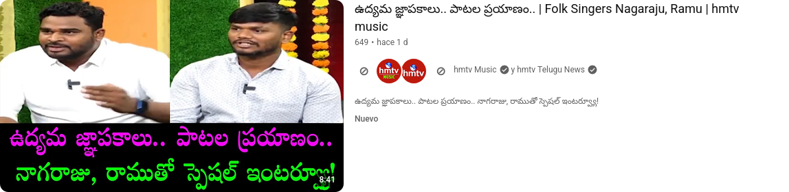

# Issue #31: collaboration controls on Spanish search results

These unedited screenshots come from successful browser tests against live YouTube, captured on November 21, 2026. They show separate ChannelFence block controls for hmtv Music and hmtv Telugu News on the reported search layout.

| Build | Browser used by CI | Passing test run |
| --- | --- | --- |
| Chrome | Chromium / Chrome for Testing 151.0.7922.34, Playwright build 1234 | [Chrome live run](https://github.com/boahs/ChannelFence/actions/runs/44875116969) |
| Firefox | Mozilla Firefox 160.0.1 | [Firefox live run](https://github.com/boahs/ChannelFence/actions/runs/44875118823) |

Both ran on Ubuntu at fix commit [`8904c5e`](https://github.com/boahs/ChannelFence/commit/8904c5e48b7d62cf04cb71cea5004c0945ea1dc6), in the `Spanish live YouTube collaborations` test, attachment `es-collaboration-buttons`. Both Spanish cases passed on the first attempt.

The screenshots capture the controls before the guest is clicked. The test then verifies that the card is hidden and only the selected guest is saved. No blocked-state or Undo image was captured. The Firefox capture uses 160.0.1; the reporter's environment was Firefox 161.

The fix is merged in [PR #33](https://github.com/boahs/ChannelFence/pull/33). These captures used the development manifest version 0.2.12 at that fix commit. Runtime source, UI, catalogs, icons and Firefox packaging inputs are unchanged in the 0.2.13 release commit [`0c7c990`](https://github.com/boahs/ChannelFence/commit/0c7c990618285addb474757f5d800f5104fa0972); the base manifest version changed. These are fix-commit captures, not screenshots of the final upload ZIPs. Final ZIP verification is recorded in [PR #35](https://github.com/boahs/ChannelFence/pull/35) and the [release package run](https://github.com/boahs/ChannelFence/actions/runs/44880383036).

The [original report and screenshot](https://github.com/boahs/ChannelFence/issues/31#issuecomment-7024939601) show the missing controls before the fix.

## Chrome build on Chromium

## Firefox build

